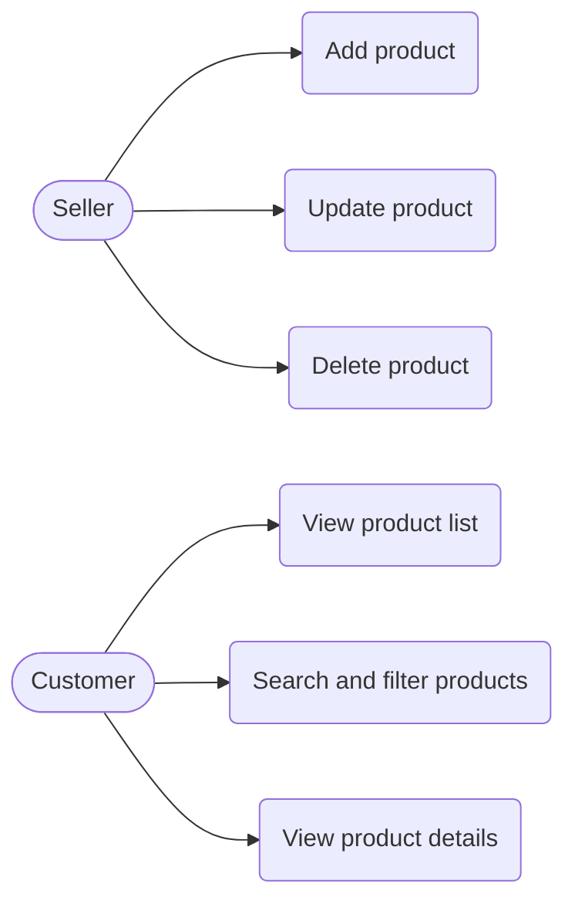
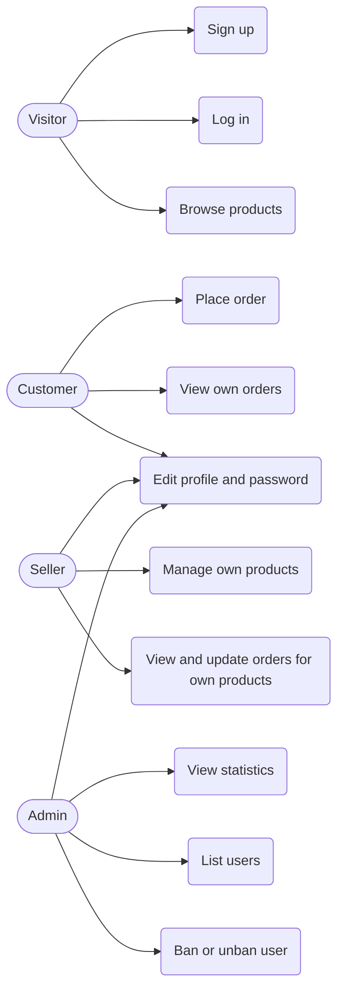
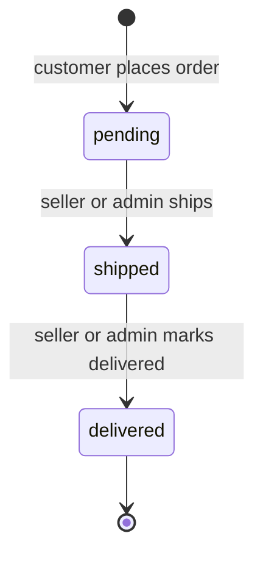

# ShopEase - Software Requirements Specification (SRS)

## 1. Introduction
### 1.1 Purpose
This SRS defines the functional and non-functional requirements of ShopEase, a web application where sellers list products, customers order them and admins manage users. Every requirement is marked **MVP** or **Beta**.

### 1.2 Scope
ShopEase is built with React (TypeScript), FastAPI (Python), SQLModel, SQLite (local) and Supabase PostgreSQL (production), deployed on Vercel. The MVP delivers a product CRUD REST API. The Beta adds authentication, RBAC, security scopes, profile, orders and an admin dashboard.

### 1.3 Definitions and Acronyms
| Term | Meaning |
|---|---|
| CRUD | Create, Read, Update, Delete |
| REST | Representational State Transfer, an HTTP API style |
| FR / NFR | Functional / Non-Functional Requirement |
| JWT | JSON Web Token, a signed token that proves who the user is |
| Access token | Short-lived JWT sent with each request |
| Refresh token | Long-lived JWT used to get a new access token |
| RBAC | Role-Based Access Control |
| Security scope | A named permission, for example `product:write` |
| MVP / Beta | Mid-term demo release / final demo release |

### 1.4 References
- PRD: [01-prd.md](01-prd.md)
- TDD: [03-tdd.md](03-tdd.md)

## 2. Overall Description
### 2.1 Product Perspective
ShopEase is a three-tier web system: a React frontend, a FastAPI backend exposing REST APIs under `/api/v1`, and a relational database.

### 2.2 Product Functions
| Function | Release |
|---|---|
| Product CRUD, list, search, filter | MVP |
| Sign up, login, refresh, profile | Beta |
| Role-based access with security scopes | Beta |
| Orders with status | Beta |
| Admin statistics, ban and unban | Beta |

### 2.3 User Classes
Customer, Seller, Admin (see 3.1).

### 2.4 Operating Environment
Modern browsers (Chrome, Firefox, Edge, Safari); FastAPI on Vercel; SQLite for local development; Supabase PostgreSQL in production.

### 2.5 Constraints
- The stack is fixed: React (TypeScript) and FastAPI (Python).
- There is no cart and no real payment (cash on delivery).
- Automated tests and CI/CD are out of scope this semester.

### 2.6 Assumptions and Dependencies
- Supabase and Vercel free tiers are available during the demos.
- The admin account is created by a seed script, not through the public API.

## 3. Functional Requirements
### 3.1 Roles
**Global roles** (one per account, Beta):

| Role | Description |
|---|---|
| `customer` | Browses products, places orders, views own orders |
| `seller` | Manages own products and the orders for them |
| `admin` | Manages users, views statistics, can manage any product and order |

Sign up allows choosing `customer` or `seller`. The `admin` role cannot be self-assigned.

**Ownership rules:**
- A seller may change a product only if the product's `seller_id` is the seller's own id.
- A customer may view only their own orders.
- A seller may view and update only orders where `seller_id` is their own id.

**Security scopes** assigned through the role:

| Role | Scopes |
|---|---|
| customer | `product:read`, `order:create`, `order:read`, `profile:write` |
| seller | `product:read`, `product:write`, `order:read`, `order:update`, `profile:write` |
| admin | `product:read`, `product:write`, `order:read`, `order:update`, `user:manage`, `stats:read`, `profile:write` |

### 3.2 Use Case Diagrams
**MVP** (no login, open endpoints):

**Beta:**

### 3.3 Order Status State Diagram (Beta)

### 3.4 Functional Requirements
**MVP**

| ID | Requirement | Release | Story |
|---|---|---|---|
| FR-001 | The system shall let a client create a product with name, description, price, stock and category. | MVP | US-01 |
| FR-002 | The system shall let a client update an existing product. | MVP | US-02 |
| FR-003 | The system shall let a client delete a product. | MVP | US-03 |
| FR-004 | The system shall return a paginated product list. | MVP | US-04 |
| FR-005 | The system shall support search by name (`q`) and filter by `category` on the product list. | MVP | US-05 |
| FR-006 | The system shall return one product by id. | MVP | US-06 |
| FR-007 | The system shall provide interactive API documentation at `/api/docs`. | MVP | US-01..US-06 |

**Beta**

| ID | Requirement | Release | Story |
|---|---|---|---|
| FR-008 | The system shall let a visitor sign up with name, email, password and role (`customer` or `seller`). | Beta | US-07 |
| FR-009 | The system shall let a user log in with email and password and return an access token and a refresh token. | Beta | US-08 |
| FR-010 | The system shall issue a new access token from a valid refresh token. | Beta | US-08 |
| FR-011 | The system shall return the logged-in user's profile. | Beta | US-09 |
| FR-012 | The system shall let a user change their name. | Beta | US-09 |
| FR-013 | The system shall let a user change their password after verifying the current password. | Beta | US-09 |
| FR-014 | The system shall allow product create, update and delete only for sellers (own products) and admins (any product). | Beta | US-10 |
| FR-015 | The system shall let a customer place an order for one product with a quantity, reduce the stock, and reject the order if stock is insufficient. | Beta | US-11 |
| FR-016 | The system shall let a customer view their own orders and order status. | Beta | US-11 |
| FR-017 | The system shall let a seller view orders for their own products. | Beta | US-12 |
| FR-018 | The system shall let a seller (own orders) or admin update the order status following the state diagram. | Beta | US-12 |
| FR-019 | The system shall give admins platform statistics. | Beta | US-13 |
| FR-020 | The system shall let an admin list users. | Beta | US-14 |
| FR-021 | The system shall let an admin ban a user. | Beta | US-14 |
| FR-022 | The system shall let an admin unban a user. | Beta | US-14 |
| FR-023 | The system shall reject login and all requests of a banned user. | Beta | US-15 |
| FR-024 | The system shall check role and security scope on every protected endpoint and return `401` (not authenticated) or `403` (not allowed). | Beta | US-10, US-14 |

### 3.5 Validation Rules
| Field | Rule |
|---|---|
| Product `name` | Required, 1 to 120 characters |
| Product `description` | Optional, up to 2000 characters |
| Product `price` | Required, greater than 0 |
| Product `stock` | Required, integer, 0 or more |
| Product `category` | Required, 1 to 60 characters |
| `page` / `page_size` | `page` >= 1 (default 1); `page_size` 1 to 50 (default 10) |
| User `name` | Required, 2 to 80 characters |
| User `email` | Required, valid email format, unique |
| User `password` | At least 8 characters |
| Order `quantity` | Integer, 1 or more |

### 3.6 Status Codes
| Code | Used when |
|---|---|
| 200 OK | Successful read or update |
| 201 Created | Resource created (product, user, order) |
| 204 No Content | Successful delete |
| 400 Bad Request | Invalid status transition |
| 401 Unauthorized | Missing, invalid or expired token; wrong credentials |
| 403 Forbidden | Role or scope not allowed, not the owner, or user is banned |
| 404 Not Found | Resource does not exist |
| 409 Conflict | Duplicate email, insufficient stock |
| 422 Unprocessable Entity | Validation rule violated |

Error body: `{"error_code": "PRODUCT_NOT_FOUND", "message": "Product not found"}`.

### 3.7 Beta Permission Matrix
✔ = allowed, ✖ = not allowed, own = only own resources.

| Action | Guest | Customer | Seller | Admin |
|---|---|---|---|---|
| View product list / product | ✔ | ✔ | ✔ | ✔ |
| Sign up / log in | ✔ | - | - | - |
| Create product | ✖ | ✖ | ✔ | ✔ |
| Update / delete product | ✖ | ✖ | own | ✔ |
| View / update own profile, change password | ✖ | ✔ | ✔ | ✔ |
| Place order | ✖ | ✔ | ✖ | ✖ |
| View orders | ✖ | own | own | ✔ |
| Update order status | ✖ | ✖ | own | ✔ |
| View statistics | ✖ | ✖ | ✖ | ✔ |
| List users, ban, unban | ✖ | ✖ | ✖ | ✔ |

### 3.8 Acceptance Criteria
| ID | Requirement | Given / When / Then | Release |
|---|---|---|---|
| AC-01 | FR-001 | **Given** valid product data, **when** the client sends `POST /api/v1/products`, **then** the response is `201` and contains the new product with an id. | MVP |
| AC-02 | FR-001 | **Given** a negative price, **when** the client creates a product, **then** the response is `422` and nothing is saved. | MVP |
| AC-03 | FR-005 | **Given** 3 products in category `books`, **when** the client requests `GET /api/v1/products?category=books`, **then** exactly those 3 are returned. | MVP |
| AC-04 | FR-006 | **Given** a product id that does not exist, **when** the client requests it, **then** the response is `404`. | MVP |
| AC-05 | FR-008 | **Given** an email already registered, **when** a visitor signs up with it, **then** the response is `409`. | Beta |
| AC-06 | FR-009 | **Given** a correct email and password, **when** the user logs in, **then** the response is `200` with an access token and a refresh token. | Beta |
| AC-07 | FR-014 | **Given** seller A and a product owned by seller B, **when** seller A sends `PUT` on it, **then** the response is `403`. | Beta |
| AC-08 | FR-015 | **Given** a product with stock 2, **when** a customer orders quantity 5, **then** the response is `409` and no order is created. | Beta |
| AC-09 | FR-015 | **Given** a product with stock 10, **when** a customer orders quantity 3, **then** the response is `201`, the order is `pending` and the stock becomes 7. | Beta |
| AC-10 | FR-018 | **Given** an order with status `pending`, **when** the seller sets it to `delivered`, **then** the response is `400`. | Beta |
| AC-11 | FR-021, FR-023 | **Given** an admin bans a user, **when** that user logs in or uses an old access token, **then** the response is `403`. | Beta |
| AC-12 | FR-024 | **Given** a customer token, **when** the client calls `GET /api/v1/admin/stats`, **then** the response is `403`; with no token it is `401`. | Beta |

## 4. Non-Functional Requirements
| ID | Category | Requirement | Release |
|---|---|---|---|
| NFR-001 | Performance | Product list, search and filter respond in 500 ms or less with 100 products. | MVP |
| NFR-002 | Security | Passwords are hashed with Argon2; plain-text passwords are never stored or logged. | Beta |
| NFR-003 | Security | Access token lifetime is 15 minutes; refresh token lifetime is 7 days. | Beta |
| NFR-004 | Security | Secrets (database URL, JWT secret) are read from environment variables and never committed to Git. | MVP, Beta |
| NFR-005 | Security | All input is validated on the server and the database is accessed only through the ORM (no string-built SQL). | MVP, Beta |
| NFR-006 | Security | CORS allows only the configured frontend origin. | Beta |
| NFR-007 | Maintainability | Backend is split into router, service and repository layers, organized by feature. | MVP, Beta |
| NFR-008 | Usability | The frontend is responsive and shows clear error messages for failed requests. | MVP, Beta |
| NFR-009 | Maintainability | All endpoints are documented automatically at `/api/docs`. | MVP |
| NFR-010 | Portability | The same code runs on SQLite (local) and PostgreSQL (production), selected by `DATABASE_URL`. | MVP |
| NFR-011 | Security | The deployed application is served over HTTPS. | MVP |

## 5. External Interface Requirements
### 5.1 User Interfaces
Responsive React + TypeScript web UI: product list and forms (MVP); login, profile, orders and admin dashboard (Beta).

### 5.2 Software Interfaces
- REST API over HTTPS under `/api/v1`, JSON payloads
- Bearer JWT in the `Authorization` header (Beta)
- Supabase PostgreSQL

### 5.3 Hardware Interfaces
No special hardware.

### 5.4 Communication Interfaces
HTTPS, JSON.

## 6. Assumptions and Constraints
1. Orders are cash on delivery; no payment is processed.
2. One order contains one product with a quantity.
3. Cart, product images, reviews and coupons are not part of this semester.

## 7. Traceability Matrix (Story → Requirement → Endpoint)
All endpoints are under `/api/v1`.

| Story | Requirement | Endpoint | Release |
|---|---|---|---|
| US-01 | FR-001 | `POST /products` | MVP |
| US-02 | FR-002 | `PUT /products/{id}` | MVP |
| US-03 | FR-003 | `DELETE /products/{id}` | MVP |
| US-04 | FR-004 | `GET /products` | MVP |
| US-05 | FR-005 | `GET /products?q=&category=` | MVP |
| US-06 | FR-006 | `GET /products/{id}` | MVP |
| US-01..06 | FR-007 | `GET /api/docs` | MVP |
| US-07 | FR-008 | `POST /auth/register` | Beta |
| US-08 | FR-009 | `POST /auth/login` | Beta |
| US-08 | FR-010 | `POST /auth/refresh` | Beta |
| US-09 | FR-011 | `GET /users/me` | Beta |
| US-09 | FR-012 | `PATCH /users/me` | Beta |
| US-09 | FR-013 | `PUT /users/me/password` | Beta |
| US-10 | FR-014, FR-024 | `POST /products`, `PUT /products/{id}`, `DELETE /products/{id}` | Beta |
| US-11 | FR-015 | `POST /orders` | Beta |
| US-11 | FR-016 | `GET /orders`, `GET /orders/{id}` | Beta |
| US-12 | FR-017 | `GET /orders` (seller scope) | Beta |
| US-12 | FR-018 | `PATCH /orders/{id}/status` | Beta |
| US-13 | FR-019 | `GET /admin/stats` | Beta |
| US-14 | FR-020 | `GET /admin/users` | Beta |
| US-14 | FR-021 | `POST /admin/users/{id}/ban` | Beta |
| US-14 | FR-022 | `POST /admin/users/{id}/unban` | Beta |
| US-15 | FR-023 | `POST /auth/login` and all protected endpoints | Beta |
