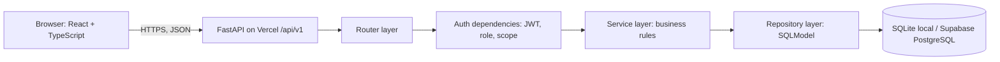
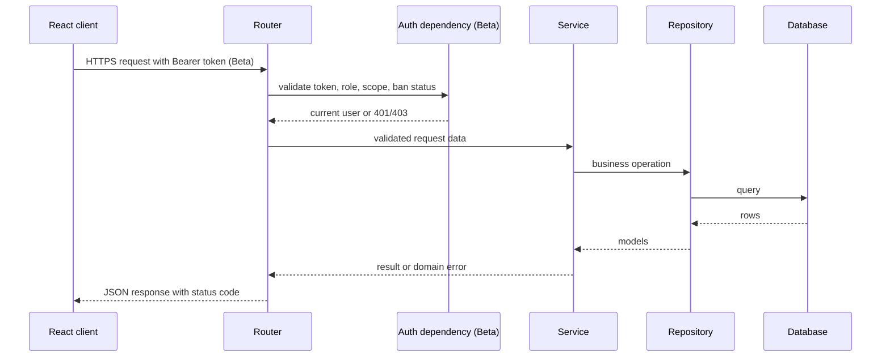
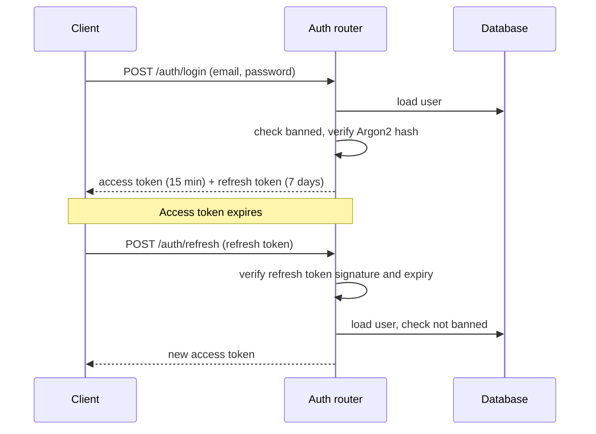
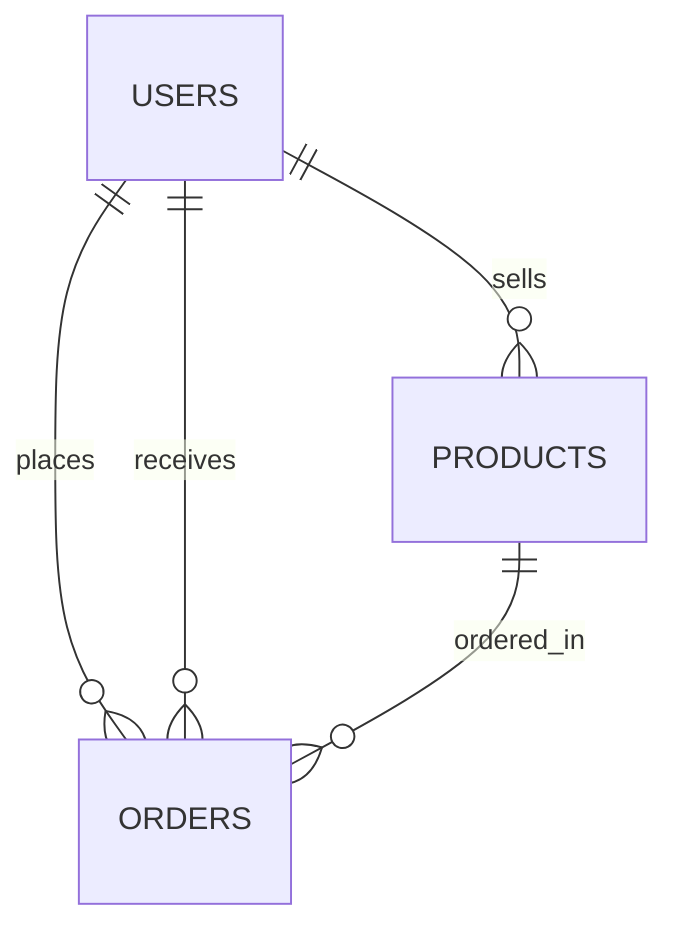

# ShopEase - Technical Design Document (TDD)

Related docs: [PRD](01-prd.md) · [SRS](02-srs.md). Every item is marked **MVP** or **Beta**.

## Technical Stack
| Layer | Technology | Release |
|---|---|---|
| Frontend | React + TypeScript + Vite | MVP |
| Backend | Python FastAPI | MVP |
| ORM | SQLModel | MVP |
| Database (local) | SQLite | MVP |
| Database (production) | Supabase PostgreSQL | MVP |
| Deployment | Vercel | MVP |
| Migrations | Alembic | Beta |
| Tokens | PyJWT (access + refresh) | Beta |
| Password hashing | Argon2 | Beta |

## Architecture


### Request Flow


### Login and Refresh Sequence (Beta)


## Project Structure
Adjust folder names to match the template; the layering stays the same.

```text
shopease/
├── docs/                      # 01-prd.md, 02-srs.md, 03-tdd.md
├── backend/
│   ├── app/
│   │   ├── main.py            # FastAPI app, /api/v1 router, error handlers
│   │   ├── core/              # config.py, database.py, security.py, deps.py
│   │   └── features/
│   │       ├── products/      # router.py, service.py, repository.py, models.py, schemas.py
│   │       ├── auth/          # Beta
│   │       ├── users/         # Beta (profile)
│   │       ├── orders/        # Beta
│   │       └── admin/         # Beta (stats, ban)
│   ├── alembic/               # Beta migrations
│   └── requirements.txt
├── frontend/                  # React + TypeScript + Vite
└── README.md
```

## Backend Design by Layer
### 1. Router (Controller) Layer
- One FastAPI router per feature under `/api/v1`: `/products`, `/auth`, `/users`, `/orders`, `/admin`.
- Responsibilities: parse and validate requests (SQLModel/Pydantic schemas), call a service, return the right status code.

### 2. Service Layer
- Business rules: seller ownership check, stock check and reduction, order status transitions, ban rules.

### 3. Repository Layer
- Only place that talks to the database through SQLModel sessions: CRUD, filtering (`q`, `category`), pagination.

### 4. Authentication and Authorization Layer (Beta)
- See "Auth, RBAC, Ban and Profile Design" below.

### 5. Error Handling
- Central exception handlers return one error shape:
```json
{
  "error_code": "PRODUCT_NOT_FOUND",
  "message": "Product not found"
}
```
- Validation errors return `422`.

### 6. Logging
- Log authentication failures, bans and unexpected errors. Never log passwords or tokens.

## Data Model
### MVP
**`products`**

| Column | Type | Notes |
|---|---|---|
| id | integer PK | |
| name | string(120) | required |
| description | string(2000) | optional |
| price | decimal(10,2) | > 0 |
| stock | integer | >= 0 |
| category | string(60) | indexed |
| created_at, updated_at | datetime | |

### Beta
A migration adds `seller_id` to `products` (existing rows are assigned to the admin) and creates the tables below.

| Table | Columns |
|---|---|
| `users` | id, name, email (unique), password_hash, role (`customer`/`seller`/`admin`), is_banned, created_at |
| `orders` | id, customer_id (FK users), seller_id (FK users), product_id (FK products), quantity, total, status (`pending`/`shipped`/`delivered`), created_at |



## REST API
Base path `/api/v1`. API docs: `/api/docs`.

### MVP (no login; open endpoints)
| Method | Endpoint | Purpose | Who | Requirement |
|---|---|---|---|---|
| GET | `/products` | List with `q`, `category`, `page`, `page_size` | Anyone | FR-004, FR-005 |
| GET | `/products/{id}` | Get one product | Anyone | FR-006 |
| POST | `/products` | Create product | Anyone | FR-001 |
| PUT | `/products/{id}` | Update product | Anyone | FR-002 |
| DELETE | `/products/{id}` | Delete product | Anyone | FR-003 |
| GET | `/api/docs` | Interactive docs | Anyone | FR-007 |

### Beta
| Method | Endpoint | Purpose | Who can call | Scope | Requirement |
|---|---|---|---|---|---|
| POST | `/auth/register` | Sign up | Guest | - | FR-008 |
| POST | `/auth/login` | Log in | Guest | - | FR-009 |
| POST | `/auth/refresh` | New access token | Any valid refresh token | - | FR-010 |
| GET | `/users/me` | Profile | customer, seller, admin | `profile:write` | FR-011 |
| PATCH | `/users/me` | Change name | customer, seller, admin | `profile:write` | FR-012 |
| PUT | `/users/me/password` | Change password | customer, seller, admin | `profile:write` | FR-013 |
| GET | `/products`, `/products/{id}` | Browse | Anyone | `product:read` | FR-004..006 |
| POST | `/products` | Create product | seller, admin | `product:write` | FR-014 |
| PUT, DELETE | `/products/{id}` | Update, delete | seller (own), admin | `product:write` | FR-014 |
| POST | `/orders` | Place order | customer | `order:create` | FR-015 |
| GET | `/orders`, `/orders/{id}` | List, view | customer (own), seller (own), admin | `order:read` | FR-016, FR-017 |
| PATCH | `/orders/{id}/status` | Update status | seller (own), admin | `order:update` | FR-018 |
| GET | `/admin/stats` | Statistics | admin | `stats:read` | FR-019 |
| GET | `/admin/users` | List users | admin | `user:manage` | FR-020 |
| POST | `/admin/users/{id}/ban` | Ban | admin | `user:manage` | FR-021 |
| POST | `/admin/users/{id}/unban` | Unban | admin | `user:manage` | FR-022 |

## Auth, RBAC, Ban and Profile Design (Beta)
- **Tokens:** PyJWT, HS256, signed with `JWT_SECRET`. The access token (15 minutes) carries `sub` (user id), `role`, `scopes`, `exp`. The refresh token is a JWT with a 7-day lifetime and `type: refresh`. Logout is done by the client discarding both tokens.
- **Password hashing:** Argon2 (`argon2-cffi`). Passwords are never stored or logged in plain text.
- **Permission dependencies:** `get_current_user` reads the Bearer token, loads the user from the database and rejects banned users with `403`. `require_scopes("product:write")` checks the token scopes and returns `403` if missing. Ownership checks (seller owns product, seller owns order, customer owns order) happen in the service layer.
- **Ban:** `POST /admin/users/{id}/ban` sets `is_banned = true`. Because `get_current_user` loads the user on every request, old tokens of a banned user are also rejected. Unban sets `is_banned = false`. An admin cannot ban themselves.
- **Profile:** `PATCH /users/me` changes the name. `PUT /users/me/password` requires the current password and applies the password rule.
- **Admin account:** created by a seed script from `ADMIN_EMAIL` and `ADMIN_PASSWORD`. Sign up cannot create admins.

## Admin Dashboard Stats Design (Beta)
`GET /admin/stats` returns one JSON object computed with count queries:

| Field | Meaning |
|---|---|
| `users_total` | Number of users |
| `users_banned` | Number of banned users |
| `products_total` | Number of products |
| `orders_total` | Number of orders |
| `orders_by_status` | Order count for `pending`, `shipped`, `delivered` |

## Security
| Measure | Design | Release |
|---|---|---|
| Password storage | Argon2 hashing | Beta |
| Tokens | Short access token, signed refresh token | Beta |
| Injection | ORM only, server-side validation | MVP |
| CORS | Only `CORS_ORIGINS` allowed | Beta |
| Secrets | Environment variables, `.env` listed in `.gitignore` | MVP |
| Transport | HTTPS on Vercel | MVP |
| Least privilege | Role scopes plus ownership checks | Beta |

## Configuration (Environment Variables)
| Variable | Example | Release |
|---|---|---|
| `DATABASE_URL` | `sqlite:///./shopease.db` locally; Supabase connection string in production | MVP |
| `CORS_ORIGINS` | frontend URL | MVP |
| `JWT_SECRET` | long random string | Beta |
| `ACCESS_TOKEN_EXPIRE_MINUTES` | `15` | Beta |
| `REFRESH_TOKEN_EXPIRE_DAYS` | `7` | Beta |
| `ADMIN_EMAIL`, `ADMIN_PASSWORD` | seed admin account | Beta |

Secrets are set in the Vercel project settings and a local `.env` file. They are never committed to Git.

## Supabase Setup
1. Create a Supabase project.
2. Copy the PostgreSQL connection string from the project's database settings.
3. Use the pooled connection string for Vercel (serverless).
4. Set it as `DATABASE_URL` in Vercel and add a PostgreSQL driver to `requirements.txt`.

## Migrations
- **MVP:** tables are created from the SQLModel models on startup.
- **Beta:** Alembic manages changes: one migration for `seller_id` on `products` and one for `users` and `orders`. Run `alembic upgrade head` before deploying.

## Deployment
1. Push the repository to GitHub and import it in Vercel (frontend and FastAPI backend as in the template).
2. Set the environment variables in Vercel.
3. Deploy from `main`; verify `/api/docs` and the product endpoints on the live URL.

## Frontend Design Highlights
- Typed API client for `/api/v1`, with TypeScript types matching the backend schemas.
- MVP pages: product list (search, filter, pagination), product form.
- Beta pages: login and sign up, profile, orders, seller product management, admin dashboard.
- Access token kept in memory; refresh on `401`; role decides which pages and menu items appear.

## Risks
| Risk | Impact | Mitigation | Release |
|---|---|---|---|
| Not enough time for orders | Beta incomplete | Keep the simple one-product order flow | Beta |
| Supabase free-tier limits or downtime | Demo fails | Keep local SQLite as backup for the demo | MVP |
| Serverless connection limits | Database errors | Use Supabase pooled connection | MVP |
| Token or secret leaks | Security breach | Env vars only, `.gitignore`, rotate secrets | Beta |
| Scope creep | Unfinished project | Keep to the scope in the PRD | MVP, Beta |

## Design-to-Requirement Mapping
| Design Area | Requirement IDs |
|---|---|
| Product feature (router, service, repository) | FR-001..FR-007, NFR-001, NFR-007 |
| Auth and tokens | FR-008..FR-010, NFR-002, NFR-003 |
| RBAC and scopes | FR-014, FR-024 |
| Profile | FR-011..FR-013 |
| Orders | FR-015..FR-018 |
| Admin stats and ban | FR-019..FR-023 |
| Security and configuration | NFR-004..NFR-006, NFR-011 |
| Database and migrations | NFR-010 |
