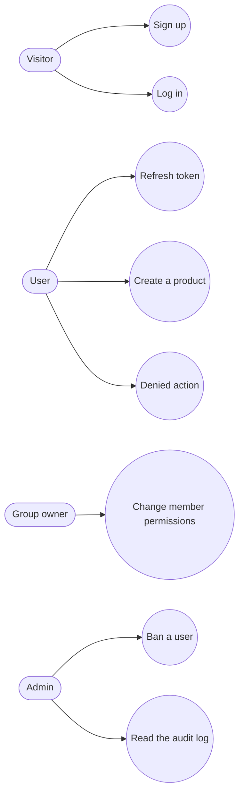
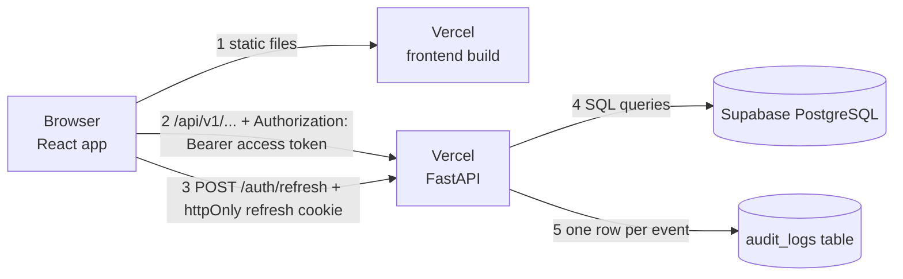
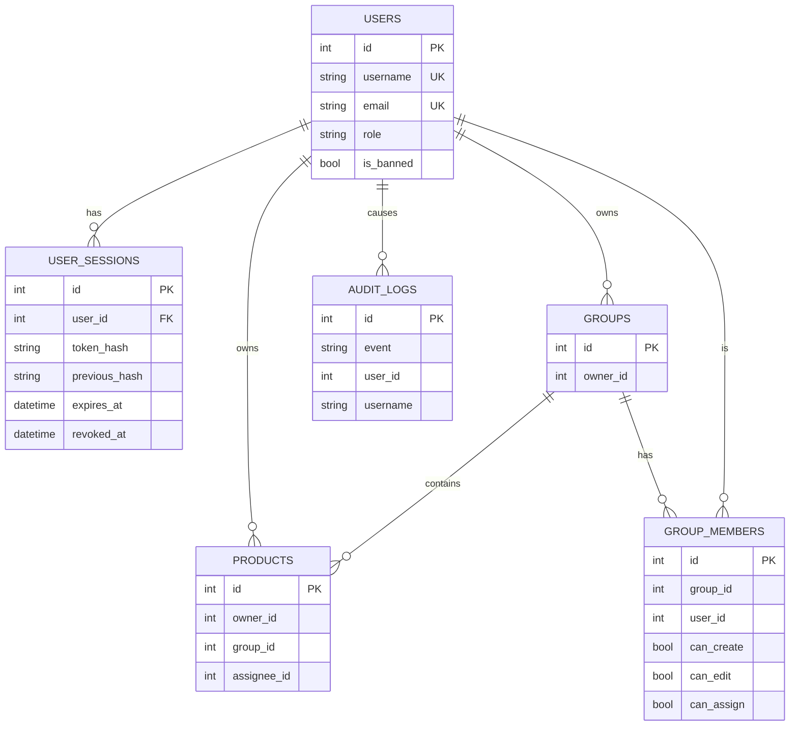
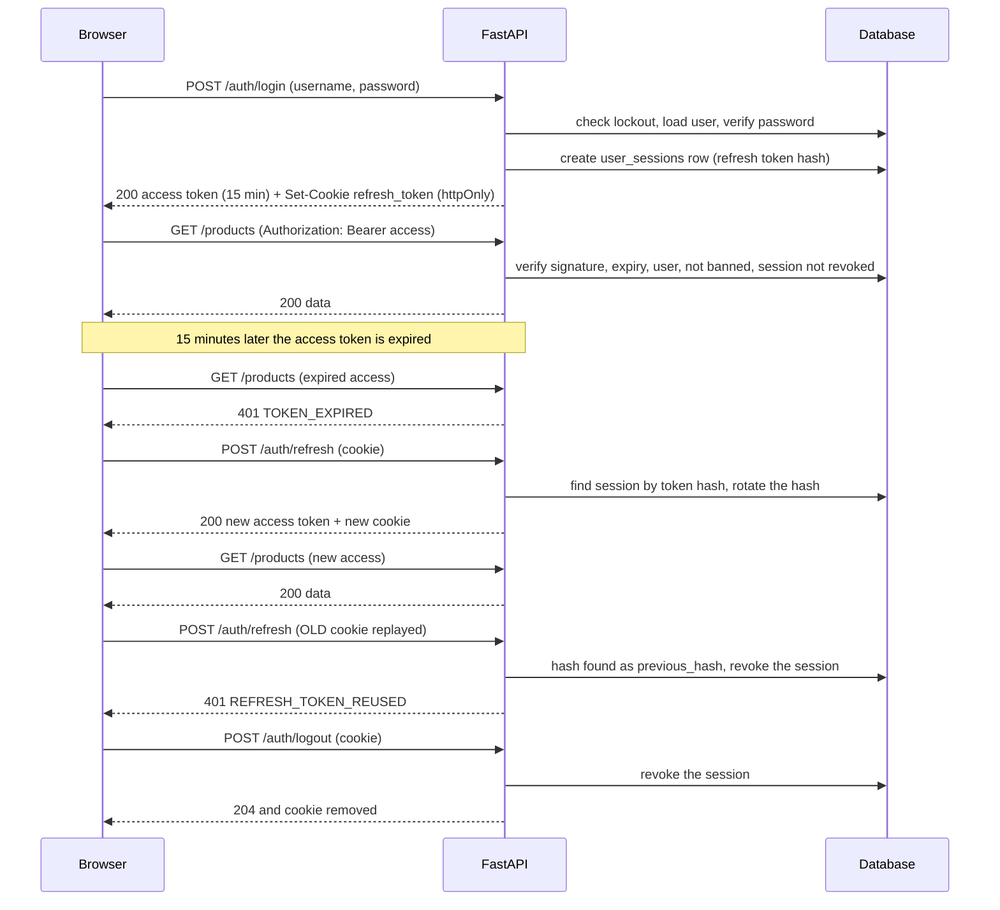
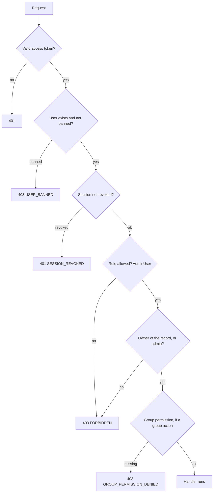
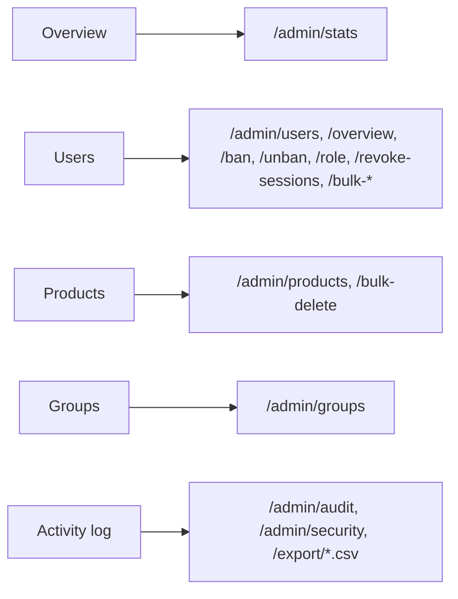
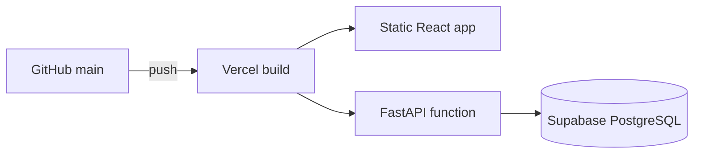

# ShopEase Final Project Report

Independent University, Bangladesh. CSE309 Web Application and Internet, Autumn 2026.

| | |
|---|---|
| Student | Ebrahim Sarwar |
| Student ID | 2331040 |
| Section | 06 |
| Project | ShopEase (multi-user shop with JWT authentication, RBAC, groups and an admin dashboard) |
| Vercel URL | https://shopease-brown-eight.vercel.app/ |
| GitHub | https://github.com/SarwarEbrahim/ShopEase- |
| Submitted to | Sayef Reyadh, Adjunct Lecturer |

Screenshots (S1 to S21) and the test accounts are in the PDF report only. This file never contains passwords.

---

# 1. Executive Summary

## 1.1 Project overview

ShopEase is a web application where people sign up, manage their own products, work together on products inside groups, and where admins control users, content and security from a dashboard. Every rule is enforced on the server. The stack is React with TypeScript (frontend), FastAPI with SQLModel (backend), Supabase PostgreSQL (database), and Vercel (hosting).

## 1.2 What was built since the mid assessment

- **JWT authentication with refresh and logout:** signup, login, a 15 minute access token, a 7 day refresh token in an httpOnly cookie that is replaced on every use, a server-side logout, a list of my sessions with revoke, and lockout after 5 failed logins.
- **Role based access control:** roles (user, admin), ownership of products, groups with create, edit and assign permissions, owner-only actions, admin self-protection, and banned users rejected on the next request.
- **Admin dashboard:** overview statistics, users (search, filters, pagination, user detail with sessions and activity, ban and unban with reason, role change, bulk actions, sign out everywhere), product and group moderation, activity log, security view, CSV exports.
- **Audit logging, brute-force protection and deployment:** every important action is written to the activity log with IP address and browser, and the system runs live on Vercel with a Supabase database, demo accounts and 43 automated tests.

## 1.3 Live links

| Item | Link |
|---|---|
| GitHub repository | https://github.com/SarwarEbrahim/ShopEase- |
| Vercel frontend | https://shopease-brown-eight.vercel.app/ |
| API base | https://shopease-brown-eight.vercel.app/api/v1 |
| API documentation | https://shopease-brown-eight.vercel.app/api/docs |
| Video demo | See the Appendix of the PDF report and the submission form |

*Table 1: links.*

---

# Part A. Product Requirements (PRD)

## A1. Problem Statement

Small online shops usually start with a simple page where anybody can add, change or delete products. This works for one person, but it fails as soon as several people use the system: nobody knows who changed a price, one customer can see or delete another customer's data, staff cannot share work safely, and the owner has no way to see abuse or block a bad account.

Today such shops cope with shared passwords or manual checks, and a single mistake or a stolen password can damage all data. ShopEase solves this by giving every person their own account, letting each person work only with their own records, letting small teams share records with exactly the permissions the group owner gives, and giving admins tools to see what happens and to act.

## A2. Users and Roles

| Role | Who they are | Main tasks | Must never be able to |
|---|---|---|---|
| Visitor | A person without an account | Sign up, log in | See any product, group or admin page |
| User | A registered person | Manage own products, profile, password and sessions, create groups | Read or change another user's product, open admin pages, change own role |
| Group member | A user who was added to a group | Work on the group's products within the permissions the owner gave (create, edit, assign) | Do something the owner did not allow, rename or delete the group, manage members |
| Group owner | The user who created the group | Everything in the group: members and their permissions, rename, delete, delete products | Be restricted inside own group |
| Admin | A trusted operator | See statistics, manage users, moderate products and groups, read the activity log and security view, export CSV | Change own role, ban self, ban another admin |

*Table 2: users and roles.*

## A3. Goals and Success Measures

| ID | Goal | Measure (yes or no check) |
|---|---|---|
| G1 | Only known people can use the system | Every endpoint except signup and login returns 401 without a valid token (test `test_missing_token_is_401`) |
| G2 | No user can read another user's data | A product of user A requested by user B returns 403 (test `test_user_cannot_read_change_or_delete_another_users_product`) |
| G3 | Sessions are short-lived and revocable | The access token expires after 15 minutes, and after logout or revoke the old access token is rejected at once with 401 (tests `test_expired_token_is_401`, `test_logout_closes_the_session_on_the_server`) |
| G4 | A stolen refresh token is detected | Using an old refresh token again closes the whole session (test `test_reusing_an_old_refresh_token_closes_the_session`) |
| G5 | Teams can share work with limited rights | A member without a permission gets 403 for that action (test `test_group_member_without_permission_gets_403`) |
| G6 | Admins can control abuse | A banned user is rejected on the next request (test `test_banned_user_is_rejected_on_the_next_request`) |
| G7 | The system is live and checkable | The Vercel URL opens, and the instructor can log in with the demo accounts |

*Table 3: goals and measures.*

## A4. Scope and Non-Goals

**In scope:** signup and login, password hashing, JWT access and refresh tokens, logout, sessions list and revoke, profile and password change, lockout, roles and ownership, products, groups with member permissions, admin dashboard, activity log and security view, CSV export, deployment on Vercel, demo data, automated tests.

**Out of scope (and why):**

- Orders, payments and a shopping cart: the course goal is authentication, authorization and administration, not e-commerce flows.
- Email verification and password reset by email: needs an email service that is not part of the free setup.
- Hiding content instead of deleting it: moderation deletes records; a hide state was not needed for the goals.
- Frontend automated tests: the effort went to the API tests, where the security rules are.

**Assumptions and constraints:** a modern browser (Chrome, Edge, Firefox) with cookies and JavaScript on; the free Vercel and Supabase plans (a free Supabase project can pause when unused); all demo data is fake; limited time before the final deadline.

## A5. User Stories

| ID | Story |
|---|---|
| US-01 | As a visitor I want to sign up with a username, email and password so that I get my own account. |
| US-02 | As a user I want to log in and stay logged in while I work so that I do not type my password again and again. |
| US-03 | As a user I want to see where I am logged in and sign out a device so that I can protect my account if I lose a phone. |
| US-04 | As a user I want to change my password and be asked for the current one so that nobody can change it with only my open browser. |
| US-05 | As a user I want to see only my own products so that my data stays private. |
| US-06 | As a group owner I want to give each member only the permissions they need so that the team cannot break things. |
| US-07 | As a group member I want to add or edit group products if the owner allowed it so that I can help the team. |
| US-08 | As a user I want a clear refusal (403) when I try something I may not do so that I understand what happened. |
| US-09 | As an admin I want to see statistics and find users by search and filters so that I can understand the system. |
| US-10 | As an admin I want to ban a user with a reason and see the user's sessions and recent activity so that I can act with evidence. |
| US-11 | As an admin I want to read the activity log and the failed logins by IP and account so that I can spot attacks. |
| US-12 | As an admin I want to export users, products and the log as CSV so that I can report outside the system. |
| US-13 | As an admin I want to delete bad products or groups, one or many, so that I can clean the system. |

*Table 4: user stories.*

---

# Part B. Software Requirements (SRS)

## B1. Introduction

**Purpose.** This part says exactly what ShopEase shall do. **Readers:** the course instructor, and any developer who continues the project.

| Term | Meaning |
|---|---|
| JWT | JSON Web Token: a signed text that carries claims such as the user id |
| Access token | A short-lived JWT sent on every API request in the `Authorization: Bearer` header |
| Refresh token | A long random string kept in an httpOnly cookie, used only to get a new access token |
| RBAC | Role based access control |
| Role | A named group of rights stored on the user (`user`, `admin`) |
| Permission | One right, such as `create` inside a group |
| Audit log | The activity log: a table that records who did what, when, from where |
| Session | One login on one device; it owns one refresh token and can be revoked |

**References:** RFC 7519 (JWT), OWASP ASVS and OWASP Cheat Sheets (password storage, session management), FastAPI documentation, SQLModel documentation, argon2-cffi documentation.

## B2. Functional Requirements

### FR-AUTH: authentication

| ID | Requirement |
|---|---|
| FR-AUTH-01 | The system shall let a visitor sign up with username (3 to 30 letters, digits or underscore), email, full name and a password of at least 8 characters with a letter and a digit, reject duplicates with 409, always give the role `user`, and never return the password. |
| FR-AUTH-02 | The system shall let a user log in and shall return an access token with the claims `sub`, `role`, `sid`, `iat`, `exp` that expires after 15 minutes, and shall set the refresh token as an httpOnly, SameSite Strict cookie. |
| FR-AUTH-03 | The system shall answer a wrong password and an unknown username with the same 401 error. |
| FR-AUTH-04 | The system shall refuse logins for a username with 429 after 5 failed logins in 15 minutes, even with the right password. |
| FR-AUTH-05 | The system shall store passwords only as an argon2 hash of an HMAC-SHA256 of the password with a server-side pepper. |
| FR-AUTH-06 | The system shall exchange a valid refresh token for a new access token and a new refresh token (rotation) and shall reject a missing, expired or revoked refresh token with 401. |
| FR-AUTH-07 | The system shall close the whole session with 401 when an already used refresh token is presented again. |
| FR-AUTH-08 | The system shall close the current session on logout so that its access and refresh tokens stop working at once, and shall remove the cookie. |
| FR-AUTH-09 | The system shall list the open sessions of the current user (device, IP address, times, which one is current) and let the user revoke one of them; another user's session shall be reported as 404. |
| FR-AUTH-10 | The system shall let a user update full name and email. |
| FR-AUTH-11 | The system shall require the current password to change the password, record a wrong attempt, and sign out all other sessions after a change. |
| FR-AUTH-12 | The system shall reject a missing, malformed, tampered, wrongly signed or expired access token with 401 and a specific error code. |

*Table 5: authentication requirements.*

### FR-RBAC: authorization

| ID | Requirement |
|---|---|
| FR-RBAC-01 | The system shall check the role on the server for every request, using the role stored in the database, and shall answer 403 to a normal user on every admin endpoint. |
| FR-RBAC-02 | The system shall let a normal user list, read, change and delete only own products, filter the list by owner in the query, and answer 403 for another user's product; an admin may access all products. |
| FR-RBAC-03 | The system shall let a group member do only what the owner granted: `create` to add products, `edit` to change them, `assign` to assign a product to the owner or a member; a user outside the group shall get 403. |
| FR-RBAC-04 | The system shall allow only the group owner to rename or delete the group, delete group products and manage members. |
| FR-RBAC-05 | The system shall refuse an admin to change own role, to ban self, and to ban another admin. |
| FR-RBAC-06 | The system shall reject a banned user on the very next request with 403, close the user's sessions, and refuse the user's login. |

*Table 6: authorization requirements.*

### FR-ADM: admin

| ID | Requirement |
|---|---|
| FR-ADM-01 | The system shall show statistics: users, banned users, admins, products, groups, new users and new products in 7 days, failed logins in 24 hours. |
| FR-ADM-02 | The system shall list users with search (username, email, name), filters (role, status) and pagination. |
| FR-ADM-03 | The system shall show a user detail: profile, ban reason, open sessions, the latest 10 activity entries, product count and owned group count. |
| FR-ADM-04 | The system shall ban a user with a required reason and unban a user, and shall close the user's sessions when banning. |
| FR-ADM-05 | The system shall let an admin change another user's role. |
| FR-ADM-06 | The system shall let an admin sign a user out of every device. |
| FR-ADM-07 | The system shall ban, unban and delete in bulk (up to 200 ids) and report how many items were updated and how many were skipped. |
| FR-ADM-08 | The system shall list all products and groups for moderation and let an admin delete a product, many products, or a group. |
| FR-ADM-09 | The system shall record events (login, failed login, blocked login, logout, token refresh, refresh reuse, session revoke, password change, profile update, role change, ban, unban, delete, export) with user, IP address, browser and time, and shall list them with an event filter, search and pagination. |
| FR-ADM-10 | The system shall show failed logins of the last 24 hours grouped by IP address and by account. |
| FR-ADM-11 | The system shall export users, products and the activity log as CSV, using the same filters as the lists, and shall protect cells that start with `=`, `+`, `-` or `@` against spreadsheet formula injection. |

*Table 7: admin requirements.*

### FR-DOM: the shop (domain)

| ID | Requirement |
|---|---|
| FR-DOM-01 | The system shall let a user create, read, update and delete own products (name, description, price above 0, stock 0 or more, category) with validation. |
| FR-DOM-02 | The system shall list products with search by name, category filter and pagination. |
| FR-DOM-03 | The system shall let group members work on group products only through the group endpoints, and assign a group product to a member. |

*Table 8: domain requirements.*

## B3. Non-Functional Requirements

| ID | Area | Requirement (measurable) |
|---|---|---|
| NFR-01 | Security | Secrets (`JWT_SECRET`, `PASSWORD_PEPPER`, `DATABASE_URL`, `SEED_PASSWORD`) come only from environment variables; in production the app refuses to start without them. |
| NFR-02 | Security | Login errors are generic; the response time of an unknown username is close to a wrong password (a dummy hash is verified). |
| NFR-03 | Security | The refresh cookie is httpOnly, Secure (in production), SameSite Strict and limited to the path `/api/v1/auth`. |
| NFR-04 | Performance | Lists are paginated: at most 50 products and at most 100 admin rows per page; CSV export at most 10,000 rows. |
| NFR-05 | Usability | The interface works on a phone width, and shows loading, error and empty states. |
| NFR-06 | Reliability | All data is in a hosted PostgreSQL database and survives restarts and redeployments. |
| NFR-07 | Maintainability | All role and permission rules are in one module (`features/auth/rbac.py`); each feature has router, service and repository layers. |
| NFR-08 | Maintainability | 43 automated API tests run with one command (`python -m pytest`) on a temporary database. |
| NFR-09 | Consistency | Every application error has the body `{"error_code": "...", "message": "..."}`; validation errors use status 422. |

*Table 9: non-functional requirements.*

## B4. Roles and Permission Matrix

Legend: yes, no, own (only own records), perm (only with the group permission).

| Endpoint group | Visitor | User | Group member | Group owner | Admin |
|---|---|---|---|---|---|
| Signup, login, refresh | yes | yes | yes | yes | yes |
| Own profile, password, sessions, logout | no | own | own | own | own |
| Products (`/products`) | no | own | own | own | all |
| Group list and group detail | no | no | member groups | own groups | all groups |
| Group products | no | no | perm | yes | all groups |
| Group rename, delete, members | no | no | no | yes | delete only (moderation) |
| Admin dashboard (`/admin/*`) | no | no | no | no | yes |

*Table 10: endpoint groups by roles.*

| Group action | Needs |
|---|---|
| View group, members and products | owner, member, or admin |
| Add a product | owner, or `create` |
| Change a product | owner, or `edit` |
| Assign a product to the owner or a member | owner, or `assign` |
| Delete a product, rename or delete the group, add, change or remove members | owner only |

*Table 11: group permissions.*

| Admin rule | Detail |
|---|---|
| Change own role | Not allowed (403 `CANNOT_MODIFY_SELF`) |
| Ban self | Not allowed (403 `CANNOT_MODIFY_SELF`) |
| Ban another admin | Not allowed (403 `CANNOT_MODIFY_ADMIN`) |
| Extra rights inside a group | None. An admin can look at any group and delete a group or a product as moderation, but cannot act as a member. |
| Bulk ban | Admins and the admin itself are skipped and counted |

*Table 12: admin rules.*

## B5. Use Cases



*Figure 1: use case diagram.*

| ID | UC-01 Log in and refresh |
|---|---|
| Actor | User |
| Precondition | The user has an account that is not banned |
| Main flow | 1. The user sends username and password to `POST /auth/login`. 2. The server checks the lockout, then the password. 3. The server creates a session, returns an access token and sets the refresh cookie. 4. The app sends the access token on every request. 5. When the access token expires, the server answers 401. 6. The app calls `POST /auth/refresh` once, receives a new access token and a new cookie, and repeats the request. |
| Alternative and error flows | Wrong credentials: 401 `INVALID_CREDENTIALS`. 5 failures in 15 minutes: 429 `TOO_MANY_ATTEMPTS`. Banned: 403 `USER_BANNED`. Refresh cookie missing or revoked: 401, the app shows the login page. Old refresh token reused: 401 `REFRESH_TOKEN_REUSED` and the session is closed. |
| Postcondition | One open session; login (and token refresh) events are in the activity log |

| ID | UC-02 Create a record |
|---|---|
| Actor | User |
| Precondition | Logged in |
| Main flow | 1. The user fills the product form. 2. The app sends `POST /products`. 3. The server validates the body and stores the product with `owner_id` set to the user. 4. The product appears in the user's list. |
| Alternative and error flows | Invalid body: 422 with the field and reason. No or expired token: 401. |
| Postcondition | The product exists and only its owner and admins can access it |

| ID | UC-03 Change a member's permissions |
|---|---|
| Actor | Group owner |
| Precondition | The group exists and the user owns it; the other user is a member |
| Main flow | 1. The owner opens the group page. 2. The owner ticks or unticks create, edit or assign for a member. 3. The app sends `PATCH /groups/{id}/members/{user_id}`. 4. The new permissions apply at the next request of the member. |
| Alternative and error flows | The caller is not the owner: 403 `NOT_GROUP_OWNER`. The user is not a member: 400 `NOT_A_MEMBER`. |
| Postcondition | The member row holds the new flags |

| ID | UC-04 A denied action |
|---|---|
| Actor | User |
| Precondition | Logged in as a normal user |
| Main flow | 1. The user opens the admin page or calls `GET /admin/users`. 2. The server reads the role from the database. 3. The server answers 403 `FORBIDDEN`. 4. The app shows a message. |
| Alternative and error flows | No token: 401. Group member without the permission: 403 `GROUP_PERMISSION_DENIED`. Another user's product: 403 `FORBIDDEN`. |
| Postcondition | Nothing changed |

| ID | UC-05 Ban a user |
|---|---|
| Actor | Admin |
| Precondition | Logged in as admin; the target is a normal user |
| Main flow | 1. The admin opens Users, finds the user and presses Ban. 2. The admin writes a reason. 3. The app sends `POST /admin/users/{id}/ban`. 4. The server marks the user banned and closes all the user's sessions. 5. The `ban` event is written to the activity log. 6. The user's next request returns 403 `USER_BANNED`. |
| Alternative and error flows | Target is self: 403 `CANNOT_MODIFY_SELF`. Target is an admin: 403 `CANNOT_MODIFY_ADMIN`. Empty reason: 422. Unknown id: 404. |
| Postcondition | The user is banned until an admin unbans |

| ID | UC-06 Read the audit log |
|---|---|
| Actor | Admin |
| Precondition | Logged in as admin |
| Main flow | 1. The admin opens the Activity log tab. 2. The app calls `GET /admin/audit` with the event filter and search text. 3. The server returns one page, newest first, with user, IP address, browser, detail and time. 4. The admin can export the same filter with `GET /admin/export/audit.csv`. |
| Alternative and error flows | Normal user: 403. Invalid page size: 422. |
| Postcondition | The export is also recorded as an `export` event |

*Table 13: use case descriptions.*

## B6. Acceptance Criteria

| ID | Requirement | Given | When | Then |
|---|---|---|---|---|
| AC-01 | FR-AUTH-12 | A user with an access token older than 15 minutes | The user calls `GET /auth/me` | 401 with `TOKEN_EXPIRED` |
| AC-02 | FR-AUTH-12 | A valid token whose payload was edited to role admin | The user calls `GET /auth/me` | 401 with `TOKEN_INVALID` |
| AC-03 | FR-RBAC-02 | Two users A and B, A owns a product | B reads, changes or deletes it | 403 `FORBIDDEN` for all three, and B's list is empty |
| AC-04 | FR-RBAC-03 | A member with only `assign` | The member adds a product to the group | 403 |
| AC-05 | FR-RBAC-06 | A logged in user | An admin bans the user and the user sends a request with the old token | 403 `USER_BANNED` |
| AC-06 | FR-RBAC-05 | Admin A and admin B | A bans B | 403 `CANNOT_MODIFY_ADMIN` |
| AC-07 | FR-AUTH-07 | A refresh token that was already exchanged | The same old token is sent again | 401 `REFRESH_TOKEN_REUSED`, and the new refresh token and old access token stop working |
| AC-08 | FR-AUTH-08 | A logged in user | The user logs out | The old access token gives 401 `SESSION_REVOKED` and refresh gives 401 |
| AC-09 | FR-AUTH-04 | A user with 5 failed logins in 15 minutes | The user logs in with the right password | 429 `TOO_MANY_ATTEMPTS` |
| AC-10 | FR-AUTH-11 | A user logged in on two devices | Device 1 changes the password | Device 2 gets 401, device 1 stays logged in |

*Table 14: acceptance criteria.*

## B7. Traceability Matrix

| Requirement | Endpoint or screen | Automated test (file `tests/`) | Screenshot (PDF) |
|---|---|---|---|
| FR-AUTH-01 | `POST /auth/signup`, signup page | `test_auth.py::test_signup_*` (4 tests) | S1 |
| FR-AUTH-02 | `POST /auth/login`, login page | `test_login_returns_access_token_with_claims_and_cookie` | S8 |
| FR-AUTH-03 | `POST /auth/login` | `test_wrong_password_and_unknown_user_look_the_same` | S1 |
| FR-AUTH-04 | `POST /auth/login`, security view | `test_lockout_after_five_failed_logins` | S16 |
| FR-AUTH-05 | `core/security.py` | `test_password_hash_is_salted_peppered_and_verifiable` | S21 |
| FR-AUTH-06 | `POST /auth/refresh`, `api.ts` | `test_refresh_gives_new_access_token_and_rotates_cookie`, `test_refresh_without_cookie_is_401` | S8 |
| FR-AUTH-07 | `POST /auth/refresh` | `test_reusing_an_old_refresh_token_closes_the_session` | S21 (test output) |
| FR-AUTH-08 | `POST /auth/logout`, Log out button | `test_logout_closes_the_session_on_the_server` | S15 |
| FR-AUTH-09 | `GET`, `DELETE /auth/sessions`, profile page | `test_sessions_list_and_revoke_other_device`, `test_cannot_revoke_someone_elses_session` | S4 |
| FR-AUTH-10 | `PATCH /auth/me`, profile page | `test_profile_update` | S3 |
| FR-AUTH-11 | `POST /auth/change-password`, profile page | `test_change_password_needs_current_password`, `test_change_password_signs_out_other_devices` | S3 |
| FR-AUTH-12 | every protected endpoint | `test_missing_token_is_401`, `test_garbage_token_is_401`, `test_tampered_token_is_rejected`, `test_expired_token_is_401`, `test_token_signed_with_another_algorithm_is_rejected` | S7 |
| FR-RBAC-01 | `/admin/*`, admin menu | `test_normal_user_cannot_use_admin_endpoints`, `test_admin_can_use_admin_endpoints`, `test_admin_endpoint_without_token_is_401` | S6 |
| FR-RBAC-02 | `/products`, products page | `test_user_sees_only_own_products`, `test_user_cannot_read_change_or_delete_another_users_product`, `test_admin_can_read_any_product` | S2, S6 |
| FR-RBAC-03 | `/groups/*`, group page | `test_group_member_with_create_and_edit_...`, `test_group_member_without_permission_gets_403`, `test_group_assign_permission`, `test_outsider_cannot_see_the_group` | S5 |
| FR-RBAC-04 | `/groups/*`, group page | `test_only_the_owner_can_rename_delete_and_manage_members` | S5 |
| FR-RBAC-05 | `/admin/users/*` | `test_admin_cannot_change_own_role_or_ban_self_or_another_admin` | S13 |
| FR-RBAC-06 | every protected endpoint | `test_banned_user_is_rejected_on_the_next_request` | S9 |
| FR-ADM-01 | `GET /admin/stats`, Overview tab | `test_stats_and_user_search` | S10 |
| FR-ADM-02 | `GET /admin/users`, Users tab | `test_stats_and_user_search` | S11 |
| FR-ADM-03 | `GET /admin/users/{id}/overview`, User detail panel | `test_user_overview_shows_sessions_and_activity` | S12 |
| FR-ADM-04 | `POST /admin/users/{id}/ban`, `unban` | `test_banned_user_is_rejected_on_the_next_request` | S13 |
| FR-ADM-05 | `PATCH /admin/users/{id}/role` | `test_admin_cannot_change_own_role_or_ban_self_or_another_admin` | S11 |
| FR-ADM-06 | `POST /admin/users/{id}/revoke-sessions` | `test_admin_can_revoke_all_sessions_of_a_user` | S12 |
| FR-ADM-07 | `POST /admin/users/bulk-ban`, `bulk-unban`, `products/bulk-delete` | `test_bulk_ban_skips_admins_and_reports_counts` | S14 |
| FR-ADM-08 | `/admin/products`, `/admin/groups` | `test_admin_can_delete_a_product` | S14 |
| FR-ADM-09 | `GET /admin/audit`, Activity log tab | `test_activity_log_records_login_and_failed_login` | S15 |
| FR-ADM-10 | `GET /admin/security` | `test_security_view_counts_failed_logins` | S16 |
| FR-ADM-11 | `/admin/export/*.csv` | `test_csv_export_is_a_download_and_guards_formulas` | S17 |
| FR-DOM-01 to 03 | `/products`, `/groups/{id}/products` | `test_user_sees_only_own_products`, `test_group_member_with_create_and_edit_...` | S2, S5 |

*Table 15: traceability matrix.*

---

# Part C. Technical Design (TDD)

## C1. Technology Stack

| Component | Technology | Version | Reason |
|---|---|---|---|
| Frontend | React with TypeScript, built with Vite | see `frontend/package.json` | Typed components; the same stack as the mid project |
| UI | Plain CSS in `index.css` | | Small and enough; no UI library to learn |
| Backend | FastAPI | 0.165 (tested) | Fast to write, automatic validation, built-in API docs |
| ORM | SQLModel on SQLAlchemy | 0.0.50 / 2.1 | One class is both table and schema |
| Database | Supabase PostgreSQL (SQLite for tests and local) | | Hosted, persistent, free plan |
| Password hashing | argon2-cffi (argon2id) with HMAC-SHA256 pepper | 25.1 | Winner of the password hashing competition; memory-hard |
| JWT library | PyJWT (HS256) | 2.x | Small, well known, checks `exp` and the algorithm |
| Testing | pytest with FastAPI TestClient (httpx) | 9.2 | Calls the real app without a server |
| Hosting | Vercel | | Free, automatic deploy from GitHub |

*Table 16: technology stack.*

## C2. System Architecture



*Figure 2: system architecture.*

1. **Static files:** the browser loads the React app from Vercel. It is the same domain as the API, so there are only same-origin requests.
2. **API calls:** the app sends the access token in the `Authorization` header on every request. The server checks it before it runs any handler.
3. **Refresh:** the refresh cookie is sent by the browser itself (JavaScript cannot read it), only to `/api/v1/auth`. The server swaps it for a new access token and a new cookie.
4. **Database:** the API reads and writes through SQLModel. Each query uses bound parameters.
5. **Audit log:** each security-relevant action writes one row to `audit_logs` in the same database.

## C3. Backend and Frontend Structure

```text
backend/
  main.py                      app, error handler, startup (tables, migration, seed)
  core/                        config.py, database.py, errors.py, security.py, utils.py
  features/
    auth/                      models, schemas, router, service, repository,
                               session_repository, dependencies, rbac, seed
    products/                  models, schemas, router, service, repository
    groups/                    models, schemas, router, service, repository
    admin/                     schemas, router, service, repository, exports
    audit/                     models, repository, service
  tests/                       conftest, helpers, test_auth, test_rbac, test_admin
frontend/
  src/
    App.tsx, AuthContext.tsx, api.ts, auth.ts, types.ts, index.css
    components/                AuthPage, ProductList, ProductForm, ProductDetail,
                               ProfilePage, SessionsList, GroupsPage, GroupView,
                               AdminPage, AdminUsers, UserDetailPanel, AdminProducts,
                               AdminGroups, AdminAudit
```

*Figure 3: folder trees (two levels).*

**Backend.** `router.py` files only handle HTTP. `service.py` files hold the rules. `repository.py` files hold the database queries. Models are in `models.py`. The authentication code is `core/security.py` (hashing and tokens), `features/auth/service.py` (login, refresh, sessions) and `features/auth/dependencies.py` (checks the token on each request). The RBAC module is `features/auth/rbac.py`. The admin code is `features/admin/`.

**Frontend.** Pages are in `components/`. `api.ts` is the only place that calls the API: it adds the token, refreshes on 401 and repeats the request once. `AuthContext.tsx` holds the logged in user. Route guards are in `App.tsx`: guests see only login, only admins see the admin page.

## C4. Data Model



*Figure 4: ER diagram.*

**Table `users`**

| Column | Type | Constraints |
|---|---|---|
| id | integer | primary key |
| username | varchar(30) | unique, indexed |
| email | varchar(254) | unique, indexed |
| full_name | varchar(100) | required |
| password_hash | text | required (argon2 hash) |
| role | varchar(20) | indexed, `user` or `admin` |
| is_banned | boolean | default false |
| ban_reason | varchar(300) | optional |
| created_at, updated_at | timestamp | UTC |

**Table `user_sessions`** (one row per login)

| Column | Type | Constraints |
|---|---|---|
| id | integer | primary key (the `sid` claim of the access token) |
| user_id | integer | foreign key to `users.id`, indexed |
| token_hash | varchar(64) | indexed, SHA-256 of the current refresh token |
| previous_hash | varchar(64) | indexed, hash of the previous refresh token (reuse detection) |
| ip_address, user_agent | varchar | where the session started or was last refreshed |
| created_at, last_used_at, expires_at | timestamp | expiry is 7 days after the last use |
| revoked_at, revoked_reason | timestamp, varchar(40) | set on logout, revoke, ban, password change, reuse |

**Table `products`:** id, name, description, price, stock, category (indexed), `owner_id` (indexed), `group_id` (indexed, null for personal products), `assignee_id` (indexed), created_at, updated_at.

**Table `groups`:** id, name, `owner_id` (indexed), created_at, updated_at.

**Table `group_members`:** id, `group_id`, `user_id` (both indexed, together unique), `can_create`, `can_edit`, `can_assign`, created_at. The owner is not stored here; the owner implicitly has all permissions.

**Table `audit_logs`:** id, `event` (indexed), `user_id` (indexed), `username` (indexed), ip_address, user_agent, detail, `created_at` (indexed).

**How it is stored.** Roles: one column on `users`. Bans: `is_banned` and `ban_reason`, and all sessions of the user are revoked. Sessions: one `user_sessions` row per login, only token hashes (never the token). Group membership with permissions: one `group_members` row per member. Activity log: append-only `audit_logs`. New columns on an old table (`products.owner_id`, `group_id`, `assignee_id`) are added on startup by a small migration step in `core/database.py`.

*Tables 17 to 21: data model.*

## C5. API Design

All endpoints are under the prefix `/api/v1`. Error body: `{"error_code": "...", "message": "..."}`; invalid input returns 422 with the field and reason. "Auth" means a valid access token.

| Method and path | Auth | Role or permission | Body | Success | Errors |
|---|---|---|---|---|---|
| POST `/auth/signup` | no | | username, email, full_name, password | 201 | 409, 422 |
| POST `/auth/login` | no | | username, password | 200 + cookie | 401, 403, 429, 422 |
| POST `/auth/refresh` | cookie | | none | 200 + new cookie | 401, 403 |
| POST `/auth/logout` | cookie | | none | 204 | |
| GET `/auth/me` | yes | any | | 200 | 401, 403 |
| PATCH `/auth/me` | yes | any | full_name, email | 200 | 409, 422 |
| POST `/auth/change-password` | yes | any | current_password, new_password | 204 | 400, 422 |
| GET `/auth/sessions` | yes | any | | 200 | 401 |
| DELETE `/auth/sessions/{id}` | yes | own session | | 204 | 404 |
| GET `/products` | yes | own (admin: all) | query: q, category, page, page_size | 200 | 401 |
| POST `/products` | yes | any | name, description, price, stock, category | 201 | 422 |
| GET, PUT, DELETE `/products/{id}` | yes | owner or admin | (PUT) full product | 200, 200, 204 | 403, 404, 422 |
| GET, POST `/groups` | yes | any | (POST) name | 200, 201 | 422 |
| GET `/groups/{id}` | yes | owner, member, admin | | 200 | 403, 404 |
| PATCH, DELETE `/groups/{id}` | yes | owner | (PATCH) name | 200, 204 | 403, 404 |
| POST `/groups/{id}/members` | yes | owner | username, can_create, can_edit, can_assign | 201 | 403, 404, 409 |
| PATCH, DELETE `/groups/{id}/members/{user_id}` | yes | owner | flags | 200, 204 | 400, 403 |
| GET `/groups/{id}/products` | yes | owner, member, admin | | 200 | 403 |
| POST `/groups/{id}/products` | yes | owner or `create` | product | 201 | 403, 422 |
| PUT `/groups/{id}/products/{pid}` | yes | owner or `edit` | product | 200 | 403, 404 |
| DELETE `/groups/{id}/products/{pid}` | yes | owner | | 204 | 403, 404 |
| PUT `/groups/{id}/products/{pid}/assign` | yes | owner or `assign` | user_id or null | 200 | 400, 403 |
| GET `/admin/stats`, `/admin/security` | yes | admin | | 200 | 401, 403 |
| GET `/admin/users` | yes | admin | query: q, role, is_banned, page, page_size | 200 | 403, 422 |
| GET `/admin/users/{id}`, `/admin/users/{id}/overview` | yes | admin | | 200 | 403, 404 |
| POST `/admin/users/{id}/ban` | yes | admin | reason | 200 | 403, 404, 422 |
| POST `/admin/users/{id}/unban` | yes | admin | | 200 | 403, 404 |
| PATCH `/admin/users/{id}/role` | yes | admin | role | 200 | 403, 404, 422 |
| POST `/admin/users/{id}/revoke-sessions` | yes | admin | | 200 | 403, 404 |
| POST `/admin/users/bulk-ban`, `/bulk-unban` | yes | admin | ids (1 to 200), reason | 200 (updated, skipped) | 403, 422 |
| GET `/admin/products`, `/admin/groups` | yes | admin | query: q, owner_id, page | 200 | 403 |
| DELETE `/admin/products/{id}`, `/admin/groups/{id}` | yes | admin | | 204 | 403, 404 |
| POST `/admin/products/bulk-delete` | yes | admin | ids | 200 | 403, 422 |
| GET `/admin/audit` | yes | admin | query: event, q, page, page_size | 200 | 403 |
| GET `/admin/export/users.csv`, `products.csv`, `audit.csv` | yes | admin | same filters as the lists | 200 (text/csv) | 403 |

*Table 22: endpoint list.*

## C6. JWT Authentication Design



*Figure 5: JWT sequence for login, request, expiry, refresh, reuse and logout.*

**Token claims**

| Claim | Meaning |
|---|---|
| `sub` | user id |
| `role` | role at login (the server still checks the role in the database on every request) |
| `sid` | id of the login session; revoking the session stops the token at once |
| `iat` | issued at |
| `exp` | expiry, 15 minutes after `iat` |

*Table 23: token claims.*

- **Algorithm and secret:** HS256. The secret is `JWT_SECRET` from the environment. The decoder accepts only HS256 and requires `exp` and `sub`, so a token with the algorithm `none` is rejected.
- **Lifetimes:** the access token lives 15 minutes, so a stolen one is useful only for a short time. The refresh token lives 7 days (sliding: the time starts again at each refresh), so a person who uses the site every few days stays logged in.
- **Where tokens are kept:** the access token is in `localStorage`; the refresh token is in an httpOnly cookie. **Risks:** XSS can read `localStorage` (React escapes all text and the code uses no `dangerouslySetInnerHTML`, and the token is short-lived). CSRF cannot use the access token, because it is sent by JavaScript in a header, not by the browser automatically. The cookie is SameSite Strict and limited to `/api/v1/auth`, so another site cannot make the browser send it.
- **Server checks on every request:** signature, algorithm, expiry, that the user exists, that the user is not banned, and that the session in `sid` exists and is not revoked.
- **Rotation and reuse:** every refresh replaces the refresh token and keeps the old hash as `previous_hash`. If the old token comes again, the session is revoked, so a thief and the owner cannot both stay logged in.
- **Frontend on 401:** `api.ts` calls refresh once (several parallel failures share one call, because two parallel refreshes would look like reuse) and repeats the request. If refresh fails, the token is removed and the login page is shown with "Your session has expired".

## C7. RBAC Design



*Figure 6: authorisation flow for one request.*

- **Roles and permission constants:** `user` has no extra permission; `admin` has `records:manage_all`, `users:manage` and `audit:view`. Group permissions are `create`, `edit`, `assign`.
- **The one reusable check:**

```python
# features/auth/dependencies.py
def require_roles(*allowed_roles: str):
    def checker(user: CurrentUser) -> User:
        if user.role not in allowed_roles:
            raise ForbiddenError()
        return user
    return checker

AdminUser = Annotated[User, Depends(require_roles(ROLE_ADMIN))]

# features/auth/rbac.py
def can_access_record(user: User, owner_id: int | None) -> bool:
    return owner_id == user.id or has_permission(user, PERM_RECORDS_MANAGE_ALL)
```

An endpoint is made admin-only by adding `admin: AdminUser` to its parameters.

*Code excerpt: the reusable permission check.*

- **Ownership in queries:** the product list passes `owner_id=user.id` into the SQL query for a normal user, so other users' rows are never loaded. Single-record routes check `can_access_record` after loading.
- **Adding a new role or permission:** add the constant and an entry in `ROLE_PERMISSIONS` in `rbac.py`, and use `require_roles` or `has_permission` where needed. No other file needs a role name.
- **Special rules:** admins cannot change own role, ban self, or ban another admin (`check_can_ban`, `check_can_change_role` in `features/admin/service.py`). A banned user is rejected before any role check, and the user's sessions are revoked.

## C8. Admin Dashboard Design



*Figure 7: admin pages and the endpoints they call.*

| Page | Endpoints | Filters and pagination | Actions | Audit events written |
|---|---|---|---|---|
| Overview | `/admin/stats` | none | read only | none |
| Users | `/admin/users`, `/users/{id}/overview`, `/ban`, `/unban`, `/role`, `/revoke-sessions`, `/bulk-ban`, `/bulk-unban`, `/export/users.csv` | search, role, status; 10 per page | detail, ban with reason, unban, role change, sign out everywhere, bulk ban and unban, export | `ban`, `unban`, `role_change`, `session_revoke`, `export` |
| Products | `/admin/products`, `/{id}`, `/bulk-delete`, `/export/products.csv` | search; 10 per page | delete one or many, export | `product_delete`, `export` |
| Groups | `/admin/groups`, `/admin/groups/{id}` | 10 per page | delete a group | `group_delete` |
| Activity log | `/admin/audit`, `/admin/security`, `/export/audit.csv` | event type, search text; page | read, export, security view | `export` |

*Table 24: page, endpoints, filters, actions, audit events.*

**Bulk actions** return `{"updated": n, "skipped": m}`. For example, a bulk ban skips the admin itself and other admins, and the page shows "n updated, m skipped". **CSV export** uses the same filter values as the list on the screen (the app sends them as query parameters) and at most 10,000 rows. The app downloads the file with a normal request that carries the token, then saves it.

## C9. Security Design and Threats

| Threat | Defence | Where |
|---|---|---|
| Password database leak | argon2id hash with a random salt, plus an HMAC pepper that is not in the database | `core/security.py` |
| Stolen access token | Lifetime 15 minutes; session can be revoked, which stops the token at once; ban and password change revoke sessions | `core/security.py`, `features/auth/dependencies.py` |
| Stolen refresh token | httpOnly cookie, rotation, reuse detection closes the session; stored only as a hash | `features/auth/service.py` |
| Brute-force login | 5 failures in 15 minutes lock the username (429); failures are logged and visible by IP and account | `features/auth/service.py`, `features/audit/` |
| Privilege escalation | Role is read from the database, never from the request; signup always gives `user`; extra body fields are ignored | `features/auth/dependencies.py`, `schemas.py` |
| Access to another user's record | Ownership rule in queries and checks; 403 | `features/auth/rbac.py`, `features/products/` |
| Cross-site scripting | React escapes output; no `dangerouslySetInnerHTML`; CSV cells are guarded | `frontend/src`, `features/admin/exports.py` |
| Cross-site request forgery | The access token is sent in a header, not a cookie; the refresh cookie is SameSite Strict with a limited path | `features/auth/router.py` |
| CORS misuse | Frontend and API share one domain; CORS is not enabled | `main.py` |
| Secrets in the repository | Secrets only in environment variables; only `.env.example` with no values is committed; passwords are never in README or this file | `core/config.py` |
| SQL injection | Only SQLModel and SQLAlchemy with bound parameters; no raw SQL with user input | all `repository.py` files |
| Over-posting of fields | Request schemas list only allowed fields; `role`, `is_banned`, `owner_id` are not accepted from the client (tested with `role: admin` at signup) | `schemas.py`, `test_signup_cannot_choose_role` |
| User enumeration | Same error for wrong username and wrong password, dummy hash for unknown users | `features/auth/service.py` |

*Table 25: threats and defences.*

## C10. Deployment on Vercel

One Vercel project serves both parts. The React app is built (`npm run build`) and served as static files. Requests to `/api/*` are sent to the FastAPI app through the rewrites in `vercel.json`. The frontend finds the API with the relative URL `/api/v1`, so it works on any domain. The database is a Supabase PostgreSQL project reached through the transaction pooler (the engine uses `NullPool`, which suits serverless functions). Vercel builds every pull request as a preview and the `main` branch as production.

**Redeploy:** merge a pull request into `main` (automatic), or in Vercel open Deployments, the three dots of a deployment, Redeploy. Changed environment variables apply only to a new deployment.



*Figure 8: deployment layout.*

| Variable | Purpose |
|---|---|
| `DATABASE_URL` | Supabase connection string (empty means local SQLite) |
| `JWT_SECRET` | signs access tokens |
| `PASSWORD_PEPPER` | secret mixed into passwords before hashing; must never change after users exist |
| `SEED_PASSWORD` | password of the demo accounts; accounts are created only when it is set |
| `ACCESS_TOKEN_MINUTES` | optional, default 15 |
| `REFRESH_TOKEN_DAYS` | optional, default 7 |

*Table 26: environment variable names.*

## C11. Testing

**Strategy.** 43 automated API tests call the real FastAPI app through `TestClient`, with a temporary SQLite database that the tests create themselves, so they never touch the live database. Each test creates its own users, so tests do not depend on each other. On top of that, every feature was tested by hand on the live site (Swagger and the web app), and the screenshots in the PDF were taken there.

**How to run:**

```text
cd backend
python -m venv .venv
.venv\Scripts\activate          (Linux or macOS: source .venv/bin/activate)
pip install -r requirements-dev.txt
python -m pytest -v
```

**Result of the last run: 43 passed** (screenshot S21).

| Test group | Requirement | Result |
|---|---|---|
| Signup (4 tests: valid, no role choice, weak password, duplicate) | FR-AUTH-01 | passed |
| Login claims and cookie; generic error; lockout; hashing | FR-AUTH-02 to 05 | passed |
| Refresh, rotation, reuse detection, logout | FR-AUTH-06 to 08 | passed |
| Sessions list, revoke, other user's session | FR-AUTH-09 | passed |
| Profile and password change (current password, other devices) | FR-AUTH-10, 11 | passed |
| Missing, garbage, tampered, expired, wrong-algorithm token | FR-AUTH-12 | passed |
| Admin endpoints for user and admin | FR-RBAC-01 | passed |
| Product ownership (list, read, change, delete, admin) | FR-RBAC-02 | passed |
| Group permission matrix and owner-only actions | FR-RBAC-03, 04 | passed |
| Admin self-protection | FR-RBAC-05 | passed |
| Banned user rejected on the next request | FR-RBAC-06 | passed |
| Admin: statistics, search, detail, revoke, bulk ban, delete, log, security, CSV | FR-ADM-01 to 11 | passed |

*Table 27: tests and results.*

---

# Part D. Evidence: Screenshots of the Running Application

All screenshots (S1 to S21) are in the PDF report, taken on the deployed Vercel URL with the address bar visible. They are not in this file, because the instructions say the screenshots go into the PDF. The list below says what each one proves.

| ID | Shows | Requirement |
|---|---|---|
| S1 | Signup and login page with a validation error | FR-AUTH-01, 03 |
| S2 | A user's products (only own records) | FR-RBAC-02 |
| S3 | Profile and change password with a wrong current password rejected | FR-AUTH-10, 11 |
| S4 | My sessions list with revoke | FR-AUTH-09 |
| S5 | A group page with members and their permissions | FR-RBAC-03, 04 |
| S6 | An action denied by RBAC (message in the app and 403 in the network tab) | FR-RBAC-01 |
| S7 | The Authorization header (masked) and an expired token returning 401 | FR-AUTH-12 |
| S8 | The refresh request returning a new access token, and the httpOnly cookie | FR-AUTH-02, 06 |
| S9 | A banned user rejected on the next request | FR-RBAC-06 |
| S10 to S17 | Admin: overview, users, user detail, ban dialog, moderation, activity log, security view, CSV export | FR-ADM-01 to 11 |
| S18 to S20 | Vercel production deployment, environment variable names (values hidden), live API docs | Deployment |
| S21 | pytest output: 43 passed | NFR-08 |

*Table 28: screenshot index.*

---

# Part E. Project Management and Conclusion

## E1. How to Run and Test

**Prerequisites:** Python 3.11 or newer, Node.js 20 or newer, Git.

1. Download or clone the repository.
2. **Environment file.** In `backend`, copy `.env.example` to `.env` and set your own values. Variable names: `DATABASE_URL` (leave empty for local SQLite), `JWT_SECRET`, `PASSWORD_PEPPER`, `ACCESS_TOKEN_MINUTES`, `SEED_PASSWORD`. Use long random text for the secrets and never commit `.env`.
3. **Backend:** `cd backend`, `pip install -r requirements.txt`, then `uvicorn main:app --reload` (the API runs on port 8000, docs at `/api/docs`).
4. **Frontend:** `cd frontend`, `npm install`, `npm run dev` (the dev server proxies `/api` to port 8000).
5. **Tests:** see section C11.
6. **Test accounts.** The roles are two admins (`admin1`, `admin2`) and three normal users (`user1`, `user2`, `user3`). The demo group "Demo Team" has owner `user1`, member `user2` with create and edit, and member `user3` with assign only. **The user IDs and passwords are in the PDF report (Appendix), never in this file.** Locally, the demo accounts exist only if `SEED_PASSWORD` is set before the first start.

## E2. GitHub Work

All commits and pull requests were made from my own GitHub account (`SarwarEbrahim`) using the GitHub web interface: one Issue, one branch named `sarwar/#<issue>-<title>`, one pull request that closes the issue, a green Vercel preview check, then merge. The work was done in order, one feature at a time.

| Issue | Pull request | What it delivered |
|---|---|---|
| JWT authentication (earlier issue) | earlier PR | signup, login, argon2 with pepper, access token, `CurrentUser` |
| #17 | #18 | RBAC module, admin endpoints, demo accounts |
| #19 | #20 | frontend: login, signup, session restore, role menu, admin users page |
| #21 | #22 | ownership rules, audit log, lockout, password change, admin statistics, security view, CSV export |
| #23 | #24 | admin dashboard UI, profile page |
| #25 | #26 | groups with member permissions, group moderation |
| #27 | next PR | README and this report |
| next issue | next PR | `.env.example` |
| next issue | next PR | refresh token with rotation, server-side logout, sessions list and revoke, admin user detail, 43 automated tests |

*Table 29: issues and pull requests.*

## E3. Limitations

- The access token is kept in `localStorage`, so a cross-site scripting bug could read it. It is short-lived (15 minutes) and the app escapes all output, but an httpOnly cookie for the access token would be safer. I chose the header approach because it avoids CSRF.
- The lockout is per username. An attacker who knows a username can lock that person out for up to 15 minutes. There is no limit per IP address.
- There is no email verification and no password reset by email.
- The demo accounts share one password that is set by the server variable `SEED_PASSWORD`.
- Moderation deletes records; there is no "hide" state and no undo.
- The admin sees one user's sessions but can only sign out all of them, not one by one.
- The automated tests cover the API on SQLite; there are no frontend tests, and the live PostgreSQL database was checked by hand only.
- A free Supabase project can pause when unused; the first request after a long pause can fail until the project is restored.
- Access tokens issued before the final deployment have no session id and are rejected, so users had to log in again once.
- `PASSWORD_PEPPER` cannot be changed without invalidating all passwords.

## E4. Future Work

1. Rate limit login per IP address, because the per-username lockout can be abused.
2. Email verification and password reset, because lost passwords are the most common support case.
3. Keep the access token only in memory and rely on the refresh cookie, to remove the `localStorage` risk.
4. Frontend tests and tests against PostgreSQL, so that the live setup is also covered.
5. A hide state for moderation and per-session revoke in the admin detail, to make moderation safer.
6. Two-factor authentication for admins, because their accounts have the most power.

## E5. Sources, Libraries and Tools

| Name | Version or link | Used for |
|---|---|---|
| FastAPI | 0.165 | API framework |
| SQLModel, SQLAlchemy | 0.0.50, 2.1 | database models and queries |
| Pydantic | 2.14 | request validation |
| PyJWT | 2.x | JWT creation and verification |
| argon2-cffi | 25.1 | password hashing |
| psycopg2-binary | 2.9 | PostgreSQL driver |
| pytest, httpx | 9.2, 0.29 | automated tests |
| React, TypeScript, Vite | see `frontend/package.json` | frontend |
| Supabase | https://supabase.com | hosted PostgreSQL |
| Vercel | https://vercel.com | hosting and automatic deploys |
| RFC 7519 | https://www.rfc-editor.org/rfc/rfc7519 | JWT claims |
| OWASP Cheat Sheet Series | https://cheatsheetseries.owasp.org | password storage, session management, CSRF, XSS |
| FastAPI documentation | https://fastapi.tiangolo.com | security and dependencies |
| Mermaid | https://mermaid.js.org | the diagrams in this file |

**AI tool.** I used Claude (Anthropic) as an assistant, with my instructor's permission, to explain concepts, generate code and documents step by step, and to find bugs. I uploaded every change through my own GitHub account, ran the 43 tests myself, tested the live site by hand, took the screenshots, recorded the video demo, and explained the code in the viva. The design decisions in this report (short access token, rotating refresh token in an httpOnly cookie, role read from the database, owner-only group actions) are ones I can explain.

*Table 30: sources, libraries and tools.*

---

# Appendix. Test Accounts and Video Demo

The video demo link and the test accounts (user ID, password and role of every demo account, and the group with mixed permissions) are written only in the **Appendix of the PDF report** and in the submission form. They are not in this file or anywhere else in the repository, because GitHub flags passwords committed to a repository.
