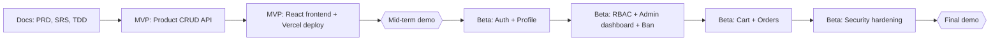

# ShopEase - Product Requirements Document (PRD)

## Product Vision
Enable customers to buy, sellers to sell and admins to oversee the store through a simple, secure and role-based e-commerce platform built on clear REST APIs.

## Problem Statement
Small sellers need an easy way to list products online and customers need an easy way to find and order them. Basic stores often have no clear separation between what customers, sellers and admins may do, which makes them insecure and hard to manage.

## Product Goals
| Goal ID | Goal | KPI | Release |
|---|---|---|---|
| PG-01 | Sellers manage products through the API | All 5 product endpoints work; 100% of MVP acceptance criteria pass | MVP |
| PG-02 | Customers find products easily | Search and filter respond in <= 500 ms with 100 products | MVP |
| PG-03 | The system runs in production | Live Vercel URL; CRUD works on Supabase PostgreSQL | MVP |
| PG-04 | Access is secure | 100% of protected endpoints return 401/403 without a valid token or role | Beta |
| PG-05 | Customers complete a purchase | Browse → cart → order → status works end to end in the demo | Beta |
| PG-06 | Admins control misuse | 100% of login attempts by a banned user are rejected | Beta |
| PG-07 | Basic security practices are followed | No plain-text passwords; no secrets in Git | Beta |

## SMART Requirement Writing Standard
All requirements in this product follow SMART criteria.

| SMART Element | How It Is Applied in ShopEase |
|---|---|
| Specific | Each requirement names the actor, the action and the system outcome |
| Measurable | Each major outcome has a KPI, status code or testable acceptance criterion |
| Achievable | Scope is limited to what the team can finish this semester |
| Relevant | Each requirement maps to a goal (PG-01..PG-07) |
| Timely | Each requirement is assigned to MVP (mid-term) or Beta (final) |

## MoSCoW Prioritization
| Category | Definition | ShopEase Usage |
|---|---|---|
| Must Have | Non-negotiable for the release | Product CRUD, login, RBAC, cart and orders |
| Should Have | Important, can slip if time is short | Search and filter, profile, admin statistics, ban and unban |
| Could Have | Added only if time remains | Product image upload |
| Won't Have (this semester) | Explicitly out of scope | Payment gateway, reviews, coupons, automated tests, CI/CD |

## Target Users
| User | Description | Release |
|---|---|---|
| Customer | Browses products, manages a cart, places and tracks orders | MVP (browsing, no login), Beta (cart, orders) |
| Seller | Lists and manages own products, handles orders for them | MVP (product management, no login), Beta (own products only, orders) |
| Admin | Manages users and monitors the platform | Beta |

In the MVP there is no login, so product endpoints are open. Roles apply from Beta.

## Release Plan
| Release | Demo | Focus |
|---|---|---|
| MVP | Mid-term | Core product features through REST APIs (CRUD), running locally and deployed on Vercel |
| Beta | Final | Authentication, RBAC, security scopes, profile, cart and orders, admin dashboard, security hardening |

## Scope
### MVP
**In scope**
- Product CRUD REST API (name, description, price, stock, category)
- Product list with pagination, search and category filter
- Interactive API documentation at `/api/docs`
- SQLite locally, Supabase PostgreSQL in production
- React + TypeScript frontend for product list and product forms
- Deployment on Vercel

**Out of scope**
- Sign up and login, roles and permissions, cart and orders

### Beta
**In scope**
- Sign up and login (JWT access token + refresh token)
- User profile (change name and password)
- Roles `customer`, `seller`, `admin` with RBAC and security scopes
- Sellers manage only their own products
- Cart and orders with order status (payment is simulated, cash on delivery)
- Admin dashboard (statistics, ban and unban users)
- Security hardening (password hashing, login lockout, input validation)

**Out of scope (this semester)**
- Real payment gateway, reviews and ratings, coupons, automated tests, CI/CD

## Feature List
| ID | Feature | Priority | Release | Requirement IDs |
|---|---|---|---|---|
| F-01 | Create, read, update, delete products | Must | MVP | FR-001..FR-003, FR-006 |
| F-02 | Product list with pagination | Must | MVP | FR-004 |
| F-03 | Search by name and filter by category | Should | MVP | FR-005 |
| F-04 | Interactive API documentation | Should | MVP | FR-007 |
| F-05 | Deployment on Vercel with Supabase PostgreSQL | Must | MVP | NFR-011, NFR-014 |
| F-06 | Sign up, login, refresh token, logout, login lockout | Must | Beta | FR-009..FR-012, FR-028 |
| F-07 | RBAC and security scopes | Must | Beta | FR-029 |
| F-08 | Seller manages only own products | Must | Beta | FR-016 |
| F-09 | Profile: change name and password | Should | Beta | FR-013..FR-015 |
| F-10 | Shopping cart | Must | Beta | FR-017 |
| F-11 | Place order, track and cancel, seller updates status | Must | Beta | FR-018..FR-022 |
| F-12 | Admin dashboard statistics | Should | Beta | FR-023 |
| F-13 | Admin bans and unbans users | Should | Beta | FR-024..FR-027 |
| F-14 | Security hardening | Must | Beta | NFR-003..NFR-007, NFR-013 |
| F-15 | Product image upload | Could | Beta | - |
| F-16 | Payment gateway | Won't | Out of scope | - |
| F-17 | Reviews, ratings, coupons | Won't | Out of scope | - |

## User Stories
### MVP
| ID | Story |
|---|---|
| US-01 | As a seller, I want to add a product with name, price, stock and category, so that customers can see it. |
| US-02 | As a seller, I want to update a product, so that its price and stock stay correct. |
| US-03 | As a seller, I want to delete a product, so that unavailable items are removed. |
| US-04 | As a customer, I want to see a list of products, so that I can browse what is available. |
| US-05 | As a customer, I want to search products by name and filter by category, so that I can find items quickly. |
| US-06 | As a customer, I want to open a single product, so that I can read its details. |

### Beta
| ID | Story |
|---|---|
| US-07 | As a visitor, I want to sign up with email and password, so that I can have an account. |
| US-08 | As a user, I want to log in and stay logged in, so that I do not enter my password again and again. |
| US-09 | As a user, I want to change my name and password, so that my profile stays up to date and secure. |
| US-10 | As a seller, I want to manage only my own products, so that other sellers cannot change them. |
| US-11 | As a customer, I want to add products to a cart, so that I can order several items together. |
| US-12 | As a customer, I want to place an order, see its status and cancel it while pending, so that I stay in control. |
| US-13 | As a seller, I want to see and update orders for my products, so that I can fulfil them. |
| US-14 | As an admin, I want to see platform statistics, so that I understand how the store is used. |
| US-15 | As an admin, I want to ban or unban a user, so that I can stop misuse. |
| US-16 | As a banned user, I should not be able to log in, so that the ban is effective. |

## Success Metrics
| Metric | Target | Release |
|---|---|---|
| Product endpoints working | 5 of 5 return correct status codes | MVP |
| MVP acceptance criteria passed | 100% at mid-term demo | MVP |
| Deployed and reachable | Live Vercel URL | MVP |
| Unauthorized requests rejected | 100% return 401 or 403 | Beta |
| Order flow completed | Browse → cart → order → status without error | Beta |
| Banned user login | 100% rejected | Beta |
| Beta acceptance criteria passed | 100% at final demo | Beta |

## Milestones
| Milestone | Release | Deliverables |
|---|---|---|
| M1: Documentation | MVP | PRD, SRS, TDD merged into `main` |
| M2: Data layer | MVP | `products` table, SQLite locally, Supabase PostgreSQL in production |
| M3: Product API | MVP | Product CRUD, list, search, API docs |
| M4: Frontend and deploy | MVP | React product pages, Vercel deployment |
| **Mid-term demo** | MVP | Demonstrate all MVP features |
| M5: Auth and profile | Beta | Sign up, login, refresh token, profile |
| M6: RBAC and admin | Beta | Roles, scopes, admin dashboard, ban and unban |
| M7: Cart and orders | Beta | Cart, orders, order status, seller order view |
| M8: Security | Beta | Hashing, login lockout, validation, secrets handling |
| **Final demo** | Beta | Demonstrate all Beta features |

## Dependencies
| Dependency | Type | Risk |
|---|---|---|
| Supabase PostgreSQL | External service | Free-tier limits or downtime |
| Vercel | Platform | Deployment configuration issues |
| Team time | Schedule | Cart and orders may not fit; fallback is ordering a single product directly |

## Acceptance Baseline
A feature is accepted only if its user story, functional requirement, endpoint and acceptance criteria are traceable in the SRS ([02-srs.md](02-srs.md), section 7).
